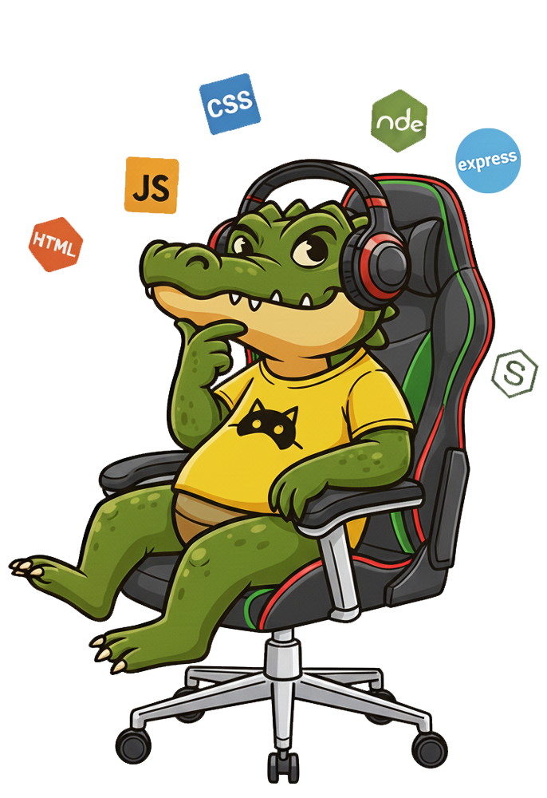
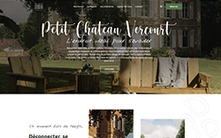
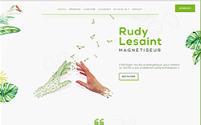
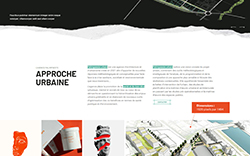
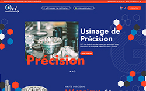
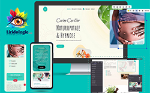
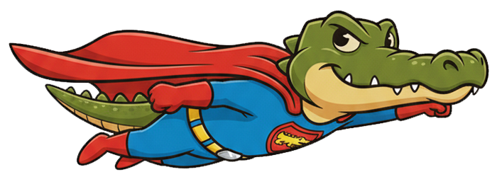

<!--
  README GITHUB - SEBASTIEN MAURICE
  Version GitHub-safe : pas d'attributs style (GitHub les ignore), images conservées
-->

<!-- ================== -->
<!-- BANNIÈRE -->
<!-- ================== -->
<div align="center">

</div>

<hr>

<!-- ================== -->
<!-- PRÉSENTATION -->
<!-- ================== -->
<table width="100%" align="center">
<tr>
<td width="60%" valign="top">

<h1>

Hello, moi c'est <strong>Sebastien</strong>
</h1>

<h3>🎨 Développeur web indépendant · Dev'n Done</h3>

<p>
Je conçois et j'optimise des sites <strong>WordPress et WooCommerce</strong> pour les TPE, artisans et PME des Hauts-de-France. Quand un CMS ne suffit plus, je développe sur mesure en <strong>Svelte, Node.js et PostgreSQL</strong>.
</p>

<p>
💡 Plus de 15 ans dans le web, du design à l'intégration. Formé chez <strong>O'clock</strong> au titre professionnel de <em>Développeur Web et Web Mobile</em>.
</p>

<ul>
<li>✨ <strong>Front-end</strong> : HTML5, CSS3 (Sass), JavaScript, Svelte</li>
<li>⚙️ <strong>Back-end</strong> : Node.js, Express, PostgreSQL, Sequelize</li>
<li>🧩 <strong>CMS</strong> : WordPress, WooCommerce, Elementor</li>
<li>🚀 <strong>Outils</strong> : Git, GitHub, API REST</li>
<li>🔍 <strong>Plus</strong> : SEO technique, Core Web Vitals, audit de sites WordPress</li>
</ul>

<p>
🌐 <strong><a href="https://devndone.com">devndone.com</a></strong> · <a href="https://www.linkedin.com/in/sebastien-maurice">LinkedIn</a> · <a href="https://www.malt.fr/profile/semauri">Malt</a>
</p>

</td>
<td width="40%" valign="top" align="right">
<br><br>
</td>
</tr>
</table>

<p align="center">
<i>💡 Amoureux du design fonctionnel, du code propre et du pixel perfect</i>
</p>

<!-- ================== -->
<!-- CROCO LAB -->
<!-- ================== -->
<div align="center">

</div>

<h2 align="center">🧪 Croco Lab : quand le code rencontre le design</h2>

<p align="center">
Un espace où créativité et rigueur se rejoignent pour concevoir des sites performants et durables.
</p>

<table width="100%" align="center">
<tr valign="top">

<td width="33%">
<h3>🎯 Design et intégration</h3>
<p>Des maquettes Figma intégrées au pixel près, responsive et accessibles.</p>
<ul>
<li>Intégration HTML, CSS, JavaScript</li>
<li>Cohérence visuelle, micro-interactions</li>
<li><strong>Outil :</strong> Figma</li>
</ul>
</td>

<td width="33%">
<h3>⚙️ Développement</h3>
<p>Du composant Svelte au service Node, en passant par des API REST claires.</p>
<ul>
<li>Svelte, Node.js, Express</li>
<li>PostgreSQL, Sequelize</li>
<li><strong>Principe :</strong> code lisible et maintenable</li>
</ul>
</td>

<td width="33%">
<h3>🚀 Performance et SEO</h3>
<p>Un site rapide, bien référencé et facile à faire évoluer.</p>
<ul>
<li>Audit technique WordPress</li>
<li>Core Web Vitals, SEO technique</li>
<li><strong>Objectif :</strong> un site qui charge vite et se trouve</li>
</ul>
</td>

</tr>
</table>

<!-- ================== -->
<!-- ACTUELLEMENT + STACK -->
<!-- ================== -->
<table width="100%" align="center">
<tr>
<td valign="top" width="60%">
<h2 align="center">🎯 Actuellement</h2>
<p>
Je développe <strong>Dev'n Done</strong> : création et refonte de sites WordPress et WooCommerce, audits techniques, SEO et développement sur mesure. Je prends des projets de sites, des interventions ciblées et du renfort pour les agences web.
</p>
<p>
Un premier échange de 15 minutes, sans engagement, se prend directement sur <a href="https://devndone.com">devndone.com</a>.
</p>
<p align="center">

</p>
</td>
<td valign="top" width="40%" align="center">

</td>
</tr>
</table>

<!-- ================== -->
<!-- RÉALISATIONS -->
<!-- ================== -->
<br>

<h2 align="center">🚀 Réalisations</h2>

<p align="center">
<em>Sites WordPress et WooCommerce conçus et intégrés sur mesure</em>
</p>

<table width="100%" align="center" cellspacing="0" cellpadding="10">
<tr valign="top">

  <!-- PROJET 1 : Petit Château Vercourt -->
  <td align="center" width="20%" valign="top">
    <a href="https://www.petitchateauvercourt.com/">
      
    </a>
    <br><br>
    <strong>🏰 Petit Château Vercourt</strong><br>
    <sub>Site vitrine pour gîte de luxe</sub><br>
    <sub>Réservation en ligne et galerie photo</sub><br><br>
    
    <br>
    
    
  </td>

  <!-- PROJET 2 : Rudy Le Saint -->
  <td align="center" width="20%" valign="top">
    <a href="https://rudylesaint-magnetiseur.com/">
      
    </a>
    <br><br>
    <strong>✨ Rudy Le Saint</strong><br>
    <sub>Site professionnel magnétiseur</sub><br>
    <sub>Prise de RDV et présentation des services</sub><br><br>
    
    <br>
    
    
  </td>

  <!-- PROJET 3 : Palimpseste Urbain -->
  <td align="center" width="20%" valign="top">
    <a href="https://www.palimpseste-urbain.com/">
      
    </a>
    <br><br>
    <strong>🏛️ Palimpseste Urbain</strong><br>
    <sub>Portfolio d'une agence d'architecture</sub><br>
    <sub>Galerie de projets et blog technique</sub><br><br>
    
    <br>
    
    
  </td>

  <!-- PROJET 4 : GSTI -->
  <td align="center" width="20%" valign="top">
    <a href="https://gsti62.com/">
      
    </a>
    <br><br>
    <strong>⚙️ GSTI</strong><br>
    <sub>Site vitrine industriel B2B</sub><br>
    <sub>Migration Wix vers WordPress, catalogue produits</sub><br><br>
    
    <br>
    
    
  </td>

  <!-- PROJET 5 : Ô Natur'EL -->
  <td align="center" width="20%" valign="top">
    <a href="https://onaturel.eu/">
      
    </a>
    <br><br>
    <strong>🌿 Ô Natur'EL</strong><br>
    <sub>Site d'une praticienne bien-être</sub><br>
    <sub>Blog santé et prise de rendez-vous</sub><br><br>
    
    <br>
    
    
  </td>

</tr>
</table>

<p align="center">
  <sub>💡 <strong>Compétences clés :</strong> développement WordPress sur mesure • optimisation SEO • responsive design • intégration de plugins • maintenance et support</sub>
</p>

<p align="center">
  👉 Toutes les réalisations : <a href="https://devndone.com/realisations">devndone.com/realisations</a>
</p>

<!-- ================== -->
<!-- PROJET FULL STACK -->
<!-- ================== -->
<h2 align="center">🧰 Projet full stack</h2>

<p align="center">
<strong><a href="https://github.com/sebastienmaurice/cinedelices">Ciné Délices</a></strong> : un site mêlant recettes de cuisine et films, développé avec Node.js, Express, EJS et PostgreSQL.
</p>

<!-- ================== -->
<!-- PHILOSOPHIE -->
<!-- ================== -->
<h2 align="center">💡 Ma philosophie</h2>

```javascript
const developer = {
  name: "Sebastien Maurice",
  company: "Dev'n Done",
  approach: "Code lisible et maintenable > code malin",
  focus: [
    "WordPress et WooCommerce",
    "Svelte et Node.js",
    "SEO et performance",
  ],
  goal: "Des sites utiles, rapides et faciles à faire évoluer 🚀",
};
console.log(`${developer.name} is ready to code! 🐊`);
```

<!-- ================== -->
<!-- EN DEHORS DU CODE -->
<!-- ================== -->
<h2 align="center">🐊 En dehors du code</h2>

<table width="100%" align="center">
<tr>
<td width="30%" align="center">

</td>
<td width="70%">
<ul>
<li>🛠️ <strong>Mon outil de base :</strong> VS Code et une bonne tasse de café ☕</li>
<li>🎯 <strong>Ma philosophie :</strong> simple, efficace, et toujours avec le sourire</li>
<li>📚 <strong>Mes bonnes pratiques :</strong> un code lisible aujourd'hui, c'est un site facile à maintenir demain</li>
</ul>
</td>
</tr>
</table>

<!-- ================== -->
<!-- ACTIVITÉ -->
<!-- ================== -->
<h2 align="center">📊 Activité</h2>
<p align="center">
<picture>
<source media="(prefers-color-scheme: dark)" srcset="https://raw.githubusercontent.com/sebastienmaurice/sebastienmaurice/output/github-contribution-grid-snake-dark.svg">
<source media="(prefers-color-scheme: light)" srcset="https://raw.githubusercontent.com/sebastienmaurice/sebastienmaurice/output/github-contribution-grid-snake-light.svg">

</picture>
</p>

<!-- ================== -->
<!-- CONTACT -->
<!-- ================== -->
<h2 align="center">📫 Me contacter</h2>
<p align="center">
<a href="https://devndone.com">

</a>
<a href="https://www.linkedin.com/in/sebastien-maurice">

</a>
<a href="https://www.malt.fr/profile/semauri">

</a>
</p>

<!-- ================== -->
<!-- FOOTER -->
<!-- ================== -->
<div align="center">

<br><sub>Fait avec ❤️ et beaucoup de ☕ par Sebastien Maurice</sub>
</div>
